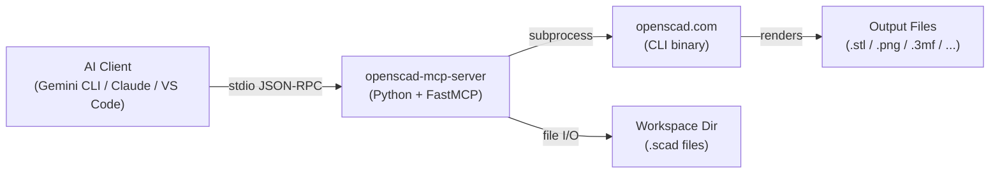

# OpenSCAD MCP Server — Implementation Plan

Build a local MCP server that gives AI assistants (Gemini CLI, Claude Desktop, VS Code Copilot) full control over OpenSCAD 2021.01 for parametric 3D modeling.

## User Review Required

> [!IMPORTANT]
> **Tech Stack: Python + FastMCP** — Given your preference for minimal dependencies, Python is recommended over TypeScript. You already have Python installed, and the only dependency is `pip install "mcp[cli]"` (~2 MB). No heavy runtimes, no build steps, no `node_modules`. The server is a single command: `python server.py`.

> [!IMPORTANT]
> **Configurability (Updated per feedback)**:
> - **OpenSCAD path** and **Workspace directory** will default to `C:\Program Files\OpenSCAD\openscad.com` and `~/openscad-workspace` respectively.
> - They can be configured via environment variables in the MCP server config (e.g., `OPENSCAD_PATH`, `OPENSCAD_WORKSPACE`).
> - Crucially, they can also be **defined or overridden at runtime** by the agent using a new `configure_server` tool, and individual tools will accept optional overrides for these paths to give full runtime flexibility.

## Open Questions - Addressed

1. **OpenSCAD install path** — Defaults to `C:\Program Files\OpenSCAD\openscad.com`, but now dynamically configurable via environment variables and a runtime `configure_server` tool.
2. **Default workspace** — Defaults to `~/openscad-workspace` but fully dynamic/configurable.
3. **Library paths** — Configurable via MCP server environment or runtime config.

---

## Architecture



**Transport**: `stdio` — the AI client spawns the server as a subprocess. Zero network config, zero ports, zero auth.

**Language**: Python 3.10+ with `mcp[cli]` (FastMCP). Single file server, ~400 lines.

**OpenSCAD interaction**: `subprocess.run()` calling `openscad.com` with appropriate flags. Stderr is captured and parsed for errors vs. echo output.

---

## Project Structure

```
c:\dev\openscad-mcp-server\
├── server.py              # Main MCP server — all tools defined here
├── openscad_runner.py     # OpenSCAD subprocess wrapper (run, validate, parse errors)
├── scad_parser.py         # Parse .scad files for customizer parameters
├── config.py              # Configuration (paths, defaults, env vars)
├── requirements.txt       # Just: mcp[cli]
├── README.md              # Setup & usage docs
├── .env.example           # Example env config
└── tests/
    ├── test_runner.py     # Tests for OpenSCAD subprocess wrapper
    ├── test_parser.py     # Tests for .scad parameter parser
    └── fixtures/
        └── test_model.scad  # Sample .scad file for testing
```

---

## Proposed Changes

### Core Server Module

#### [NEW] [server.py](file:///c:/dev/openscad-mcp-server/server.py)

The main MCP server file using FastMCP. Exposes 9 tools:

| Tool | Description | Parameters |
|------|-------------|------------|
| `configure_server` | Get or update server configuration (OpenSCAD path, workspace directory) at runtime | `openscad_path?`, `workspace_dir?` |
| `create_scad` | Create a new `.scad` file with given code | `filename`, `code`, `overwrite?` |
| `edit_scad` | Replace contents of an existing `.scad` file | `filepath`, `code` |
| `render_stl` | Render a `.scad` file to STL | `filepath`, `output_path?`, `variables?`, `format?` |
| `render_preview` | Generate a PNG preview image | `filepath`, `width?`, `height?`, `camera?`, `colorscheme?`, `variables?` |
| `export_model` | Export to any supported format (STL/3MF/AMF/OFF/DXF/SVG) | `filepath`, `format`, `output_path?`, `variables?` |
| `validate_scad` | Check `.scad` file for syntax errors without rendering | `filepath` or `code` |
| `list_models` | List all `.scad` files in the workspace | `pattern?` |
| `get_parameters` | Extract customizer parameters from a `.scad` file | `filepath` |
| `batch_export` | Render with multiple parameter sets | `filepath`, `parameter_sets[]`, `format?` |

Each tool returns structured content:
- **Text results**: status messages, error details, parameter listings
- **Image results**: base64-encoded PNG for `render_preview` (so the AI can "see" the model)

Example tool implementation pattern:
```python
from mcp.server.fastmcp import FastMCP
import subprocess, json, base64, os

mcp = FastMCP("openscad")

@mcp.tool()
def render_preview(
    filepath: str,
    width: int = 800,
    height: int = 600,
    camera: str | None = None,
    colorscheme: str = "Cornfield",
    variables: dict[str, str] | None = None
) -> list:
    """Render an OpenSCAD file to a PNG preview image.
    
    Returns the preview image so you can visually inspect the 3D model.
    Use this to verify your design looks correct before exporting.
    """
    output_path = _temp_png_path()
    cmd = _build_command(filepath, output_path, 
                         preview=True, imgsize=f"{width},{height}",
                         camera=camera, colorscheme=colorscheme,
                         variables=variables)
    result = _run_openscad(cmd)
    
    if result.success:
        with open(output_path, "rb") as f:
            img_data = base64.b64encode(f.read()).decode()
        return [
            {"type": "text", "text": f"Preview rendered: {width}x{height}"},
            {"type": "image", "data": img_data, "mimeType": "image/png"}
        ]
    else:
        return [{"type": "text", "text": f"Render failed:\n{result.stderr}"}]
```

---

### OpenSCAD Runner Module

#### [NEW] [openscad_runner.py](file:///c:/dev/openscad-mcp-server/openscad_runner.py)

Subprocess wrapper for OpenSCAD CLI:

- **`run_openscad(args)`** — Execute `openscad.com` with given arguments, capture stdout/stderr, return structured result
- **`build_command()`** — Construct command line from high-level parameters (filepath, output, variables via `-D`, camera, etc.)
- **Error detection** — Parse stderr for `ERROR:` prefixes (exit codes are unreliable in OpenSCAD); also verify output file exists and is non-empty
- **Timeout handling** — Kill the process after configurable timeout (default 120s for complex renders)
- **`-D` flag construction** — Convert a dict of variables to proper `-D 'var=value'` arguments, handling strings, numbers, vectors, and booleans

---

### SCAD Parameter Parser

#### [NEW] [scad_parser.py](file:///c:/dev/openscad-mcp-server/scad_parser.py)

Parse `.scad` files to extract customizer parameters:

- Regex-based parser for OpenSCAD customizer annotations:
  - `size = 10; // [0:100]` → slider with min/max
  - `type = "small"; // [small, medium, large]` → dropdown
  - `flag = true; // Enable feature` → checkbox
  - `/* [Section Name] */` → parameter groups
- Returns structured JSON with parameter name, type, default value, constraints, and description
- Also extracts `module` and `function` declarations for code intelligence

---

### Configuration

#### [NEW] [config.py](file:///c:/dev/openscad-mcp-server/config.py)

Configuration with sensible defaults, all overridable via environment variables:

```python
OPENSCAD_PATH = os.environ.get("OPENSCAD_PATH", r"C:\Program Files\OpenSCAD\openscad.com")
WORKSPACE_DIR = os.environ.get("OPENSCAD_WORKSPACE", os.path.expanduser("~/openscad-workspace"))
RENDER_TIMEOUT = int(os.environ.get("OPENSCAD_TIMEOUT", "120"))
DEFAULT_IMAGE_WIDTH = 800
DEFAULT_IMAGE_HEIGHT = 600
DEFAULT_COLORSCHEME = "Cornfield"
```

#### [NEW] [.env.example](file:///c:/dev/openscad-mcp-server/.env.example)

```env
OPENSCAD_PATH=C:\Program Files\OpenSCAD\openscad.com
OPENSCAD_WORKSPACE=C:\Users\you\openscad-workspace
OPENSCAD_TIMEOUT=120
```

---

### Client Configuration

#### Gemini CLI

Add to `~/.gemini/settings.json`:
```json
{
  "mcpServers": {
    "openscad": {
      "command": "python",
      "args": ["c:\\dev\\openscad-mcp-server\\server.py"],
      "env": {
        "OPENSCAD_PATH": "C:\\Program Files\\OpenSCAD\\openscad.com"
      }
    }
  }
}
```

#### Claude Desktop

Add to `%APPDATA%\Claude\claude_desktop_config.json`:
```json
{
  "mcpServers": {
    "openscad": {
      "command": "python",
      "args": ["c:\\dev\\openscad-mcp-server\\server.py"]
    }
  }
}
```

#### VS Code

Add to `.vscode/mcp.json`:
```json
{
  "servers": {
    "openscad": {
      "type": "stdio",
      "command": "python",
      "args": ["c:\\dev\\openscad-mcp-server\\server.py"]
    }
  }
}
```

---

### Documentation

#### [NEW] [README.md](file:///c:/dev/openscad-mcp-server/README.md)

Full documentation covering:
- Prerequisites (Python 3.10+, OpenSCAD 2021.01)
- Installation (clone + `pip install -r requirements.txt`)
- Configuration (env vars, client setup)
- Tool reference (all 9 tools with examples)
- Troubleshooting

---

### Tests

#### [NEW] [tests/](file:///c:/dev/openscad-mcp-server/tests/)

- `test_runner.py` — Unit tests for subprocess wrapper (mock OpenSCAD binary)
- `test_parser.py` — Tests for `.scad` parameter extraction with fixture files
- `fixtures/test_model.scad` — Sample parametric model for integration testing

---

## Verification Plan

### Automated Tests

1. **Unit tests**: `python -m pytest tests/` — test the runner, parser, and command builder with mocked subprocess
2. **Integration test**: Run `python server.py` manually and use the MCP Inspector (`npx @modelcontextprotocol/inspector`) to interactively test each tool
3. **Smoke test**: Configure in Gemini CLI settings, restart, and ask the AI to create and render a simple model

### Manual Verification

1. Create a test `.scad` file via the `create_scad` tool
2. Preview it with `render_preview` — verify the AI receives the image
3. Export to STL with `render_stl` — verify the file is valid (open in 3D viewer)
4. Test `get_parameters` on a file with customizer annotations
5. Test `validate_scad` with intentionally broken code
6. Test `batch_export` with multiple parameter sets

### Verification Commands

```powershell
# 1. Install dependencies
cd c:\dev\openscad-mcp-server
pip install -r requirements.txt

# 2. Run unit tests
python -m pytest tests/ -v

# 3. Test server starts correctly
python server.py  # Should block on stdio, ctrl+C to exit

# 4. Use MCP Inspector for interactive testing
npx @modelcontextprotocol/inspector python server.py
```

---

## Execution Phases

### Phase 1 — Foundation (~30 min)
- Create project structure
- Implement `config.py` and `openscad_runner.py`
- Verify OpenSCAD CLI invocation works

### Phase 2 — Core Tools (~45 min)
- Implement `server.py` with all 9 tools
- Implement `scad_parser.py` for parameter extraction
- Wire everything together

### Phase 3 — Testing & Polish (~20 min)
- Write tests
- Create README.md
- Add `.env.example`

### Phase 4 — Client Configuration (~5 min)
- Configure Gemini CLI `settings.json`
- Test end-to-end with a real AI conversation
